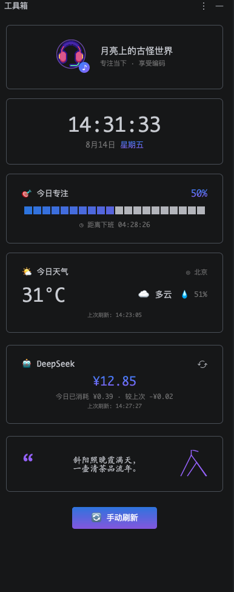
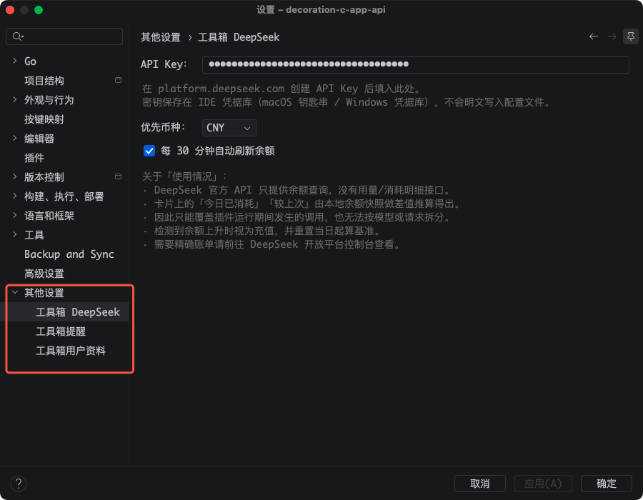

# 工具箱 (xwindow)

一个 JetBrains IDE 插件：在 IDE 右侧停靠一个「工具箱」Tool Window，以卡片形式展示实时时钟、天气、诗词、DeepSeek 余额、定时提醒、工作进度、音乐可视化等内容。

- 基于 IntelliJ Platform，仅依赖 `com.intellij.modules.platform`
- 在 GoLand 2024.2 下开发验证，可加载于 233–262.* 范围内的任意 JetBrains IDE

## 功能

- 实时时钟（每秒刷新）
- 实时天气（高德地图天气 API，每 30 分钟刷新）
- 诗词卡片与用户资料卡片
- DeepSeek 余额展示（API Key 存于 IDE 凭据库）
- 定时提醒（Cron 调度，支持持久化与通知）
- 工作进度、音乐频谱/可视化、篝火等趣味面板

## 界面预览

<table>
  <tr>
    <td align="center"></td>
    <td align="center"></td>
  </tr>
  <tr>
    <td align="center">主界面</td>
    <td align="center">设置页</td>
  </tr>
</table>

## 环境要求

- JDK 21
- 开发测试环境：GoLand 2024.2

## 构建

```bash
./gradlew buildPlugin   # 产物在 build/distributions/
```

## 运行

```bash
./gradlew runIde
```

## 配置

- **天气**：IDE 设置 → 工具箱高德地图 中填写高德「Web服务」类型 API Key（存入 IDE 凭据库，不会写入配置文件），并可配置城市编码与显示名（默认北京东城，`110101`）。
- **DeepSeek**：IDE 设置 → 工具箱 DeepSeek 中填写 API Key，密钥存入 IDE 凭据库，不会写入源码。
- **定时提醒**：IDE 设置 → 工具箱提醒。

## 开发

- 入口：`WindowFactory`；布局与刷新生命周期：`MainWindow`
- 卡片：`panel/`；展示格式化：`content/`；外部 API：`rpc/`
- 网络请求必须在后台线程执行，UI 更新需回到 EDT

## License

[MIT](LICENSE)
